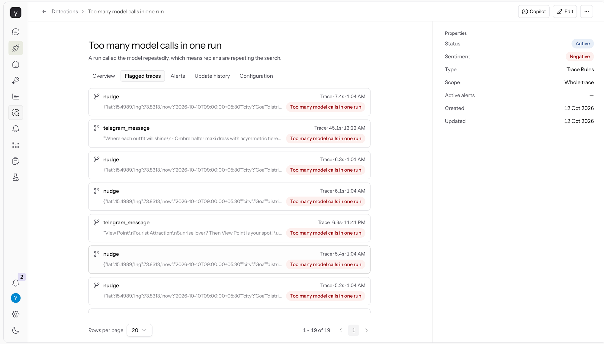
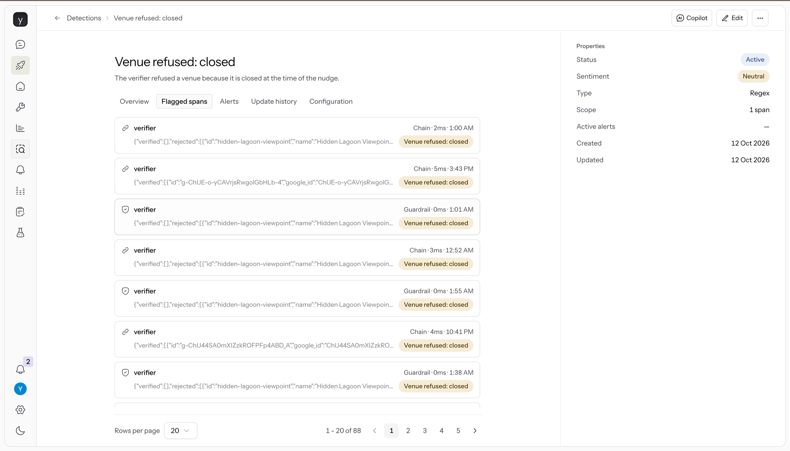
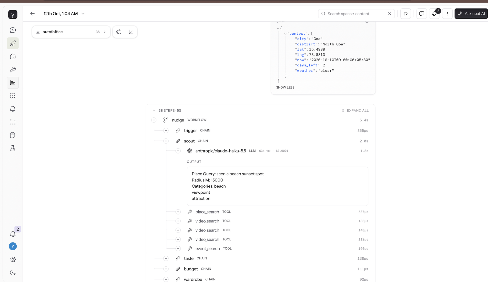
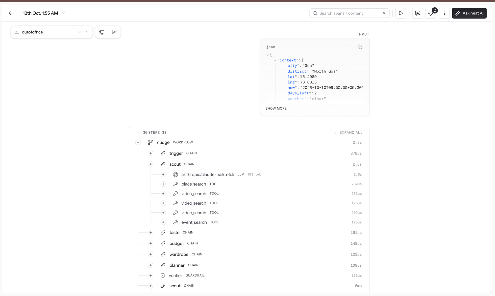
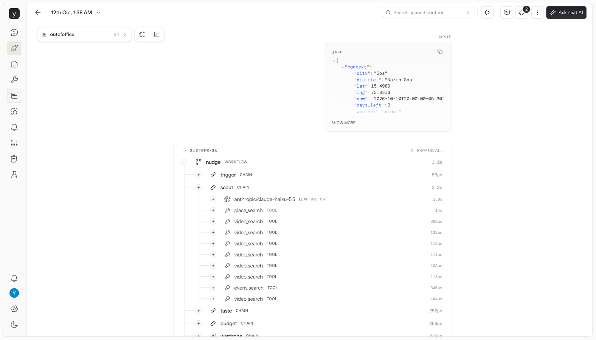

# OOO (Outofoffice)

A travel buddy that lives in your chat. It plans your trip around what you love and what you
packed, then nudges you when something nearby is worth it. Every place it suggests is checked
first (real, open now, and where the reel claims), and if nothing passes, it stays quiet.

Built for neatHack 2026 (Oct 10–12) with LangGraph, neatlogs, Entire and cfo.ai. The build log
is in [`hackathon.md`](hackathon.md).

## How it works

```
trigger → scout → taste → budget → wardrobe → planner → verifier ──pass──→ feed (one nudge)
             ↑                                              │
             └────────── fail: replan, at most twice ───────┘
```

- **scout** finds places, events, reels and shops near the traveller. One model call.
- **taste**, **budget**, **wardrobe** rank and drop candidates by what the traveller likes,
  what they have left to spend and what they packed. No model calls.
- **planner** spreads what the traveller asked for across the days they have left.
- **verifier** is the gate. A venue that does not exist, is closed right now, or is not where
  its reel claims is refused with a reason. A plan that cannot be kept is refused too.
- A refusal sends the run back to the scout to replan. After two replans the run ends with no
  nudge.

The traveller talks to it over Telegram (`app/telegram.py`). Location updates go through
`app/runtime.py`, which the simulator and the live bot both call.

## Run it

```
python -m venv .venv && source .venv/bin/activate
pip install -r requirements.txt
cp .env.example .env        # fill in NEATLOGS_API_KEY and OPENROUTER_API_KEY

python -m unittest discover -s tests          # 104 tests, no network
python -m app.graph goa_2day                  # the Goa two-day conflict, on fixtures
OO_SCENARIO=closed python -m app.graph        # every venue in range must be refused
python -m app.telegram                        # the chat bot (needs TELEGRAM_BOT_TOKEN)
```

`OO_FIXTURES=1` (the default) reads from `fixtures/`. `OO_FIXTURES=0` uses the live providers
listed in `.env.example`.

## neatlogs evidence

Three specific runs. Each has its app link, and a full export in [`evidence/`](evidence/) that
opens without a neatlogs login. The coordinates in them are the Goa demo fixture, not a person's
location.

| Run | What it shows | neatlogs trace | Export |
| --- | --- | --- | --- |
| 1. Failure (before the fix) | Two venues refused, then two replans that repeat the same 15 km search and find nothing new | [`41e85866…`](https://app.neatlogs.com/traces/41e85866c817110ff13d29aa5187e9ed?orgId=a2292b54-4117-446e-a9eb-91a59c618856&projectId=6c876950-22f7-4cc3-b50e-c789cde07355) | [trace-1-before-failure.md](evidence/trace-1-before-failure.md) |
| 2. Recovery | Trek and sunset planned on one day, refused by the verifier, sunset moved to day 2, passed | [`718e0562…`](https://app.neatlogs.com/traces/718e0562e66dcc7519c40cabcae58525?orgId=a2292b54-4117-446e-a9eb-91a59c618856&projectId=6c876950-22f7-4cc3-b50e-c789cde07355) | [trace-2-recovery.md](evidence/trace-2-recovery.md) |
| 3. Same input as run 1, after the fix | Each replan widens the search with no model call; four venues checked | [`a78e09b7…`](https://app.neatlogs.com/traces/a78e09b753d992ced6513b1226bdf962?orgId=a2292b54-4117-446e-a9eb-91a59c618856&projectId=6c876950-22f7-4cc3-b50e-c789cde07355) | [trace-3-after.md](evidence/trace-3-after.md) |

### Before and after

Same input both times: `OO_SCENARIO=closed python -m app.graph`, run 5 times before the fix and
5 times after. Run 1 is the before trace and run 3 the after trace.

| | Before (run 1) | After (run 3) | Change |
| --- | --- | --- | --- |
| Trace latency | 5.4 s | 2.8 s | 48% faster |
| Model calls | 3 | 1 | |
| Tokens | 1,956 (1,799 in, 157 out) | 678 (626 in, 52 out) | 65% fewer |
| Search radius per pass | 15, 15, 15 km | 15, 37.5, 60 km | |
| Venues the verifier checked | 2 | 4 | |
| Outcome | Silent, correctly, 5 of 5 | Silent, correctly, 5 of 5 | |

Cost is given as a share, not in money: the trace exports mark this model `pricing_status:
unpriced`, and the neatlogs app shows about $0.0001 per model call, too coarse to compare.
Tokens fell by about two thirds on the same model, so cost fell by the same share.

How the fix came about:

1. Run 1 ended with no nudge after two replans.
2. neatlogs Investigate on that trace found the root cause: the scout's model kept the same
   15 km radius on every replan, so each search returned only venues already refused. The full
   answer is in [investigate-on-trace-1.md](evidence/investigate-on-trace-1.md).
3. The patch (commit `05ea6d0`, Entire checkpoint `01M4P95QFYBZCETGSRHD212NQ0`) makes a replan
   widen the radius and try new categories without calling the model, and end at once when
   nothing is left to change.
4. Run 3 is the same input on the patched code.

### Detections

Four detections run on every trace in the neatlogs project.

| Detection | Kind | What it flags | Result on this project's traces |
| --- | --- | --- | --- |
| Venue refused: closed | Regex on the verifier's output, `closed right now` | The verifier refused a venue that is closed at the time of the nudge | 88 verifier steps |
| Too many model calls in one run | Trace rule: LLM spans repeat at least 2 times | Replans that call the model again | 19 runs, including the before runs; none of the five after runs |
| Scout fell back to default query | Regex on the scout's output, `scout used the default query` | The model call failed and the scout used its canned search | none |
| Personal data in prompts | PII on LLM spans | An email address or phone number sent to the model | none |

"Too many model calls in one run" is the fix seen by a detection: it flags the runs from before
the patch (01:04) and not the same input run after it (01:54 to 01:55). Chat runs
(`telegram_message`) are flagged too; they call the model several times by design.





### Screenshots

Run 1, before the fix: 38 steps and 5.4 s. The first model call asks for a sunset spot within
15 km; the two replans further down repeat it.



Run 3, after the fix: one model call of 678 tokens, and the second scout pass takes 5 ms.



Run 2, recovery: the whole run is one trace, with the model call and tools under the scout.


